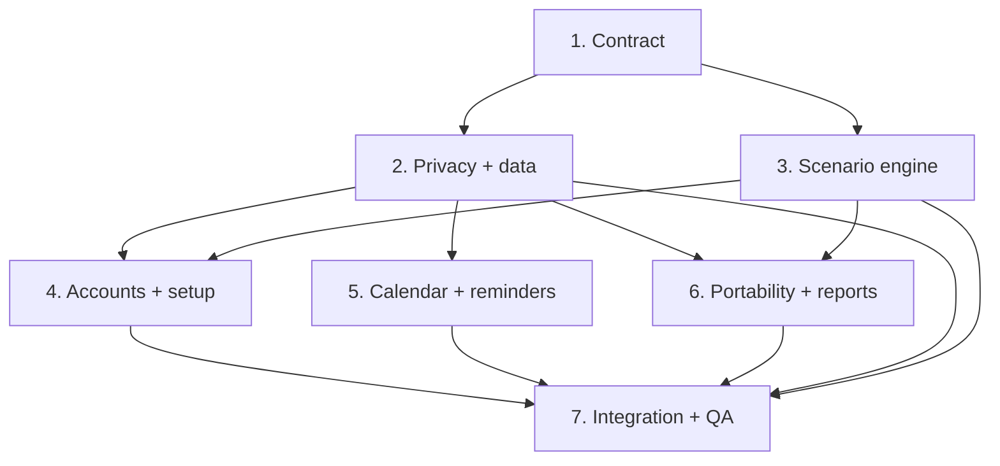

# Payday Playbook — Alpha v0.3.0 Multi-Agent Release Plan

## Outcome

Ship a backward-compatible **minor release** that adds a complete cash-account workspace, explainable extra-payment and payoff scenarios, hardened due-date/calendar behavior, safe JSON backup and reusable templates, a locally generated financial report, and a consolidated bills-and-debts setup experience.

This release must also remove personal financial information from source code, bundled fixtures, developer prompts, documentation, logs, previews, and other shareable project artifacts. Existing on-device user data must be preserved through migration; it must not be copied into source-controlled seed data.

This document is the authoritative release contract and copy-paste prompt pack for Fable 5 multi-agent work.

---

## 1. Semantic versioning decision

- Target app version: **`0.3.0`**.
- First testable prerelease tag: **`v0.3.0-alpha.1`**.
- Increment the iOS build number independently.
- Increment the persistence schema version only if the implemented model changes require it.
- Increment the calculation version because scenario and extra-payment behavior are new.
- Preserve user plan-version history independently from the app version.

This is a minor release because it adds backward-compatible screens, workflows, data portability, reporting, and calculation capabilities. Individual defects found while delivering it may receive `0.3.x` patches after `0.3.0` ships.

If the repository's actual version is not `0.2.x`, the release coordinator must derive `current major.(current minor + 1).0` and update branch/tag examples accordingly. Do not silently downgrade or reuse an existing tag.

---

## 2. Feedback translated into product requirements

| ID | Requirement | Acceptance-level behavior |
| --- | --- | --- |
| V3-01 | Release and migration | Upgrade from `v0.2.x` without losing accounts, debts, bills, actual entries, plan versions, due dates, or notification preferences. Fresh installs receive no real-person seed data. |
| V3-02 | Checking Accounts page | Show every active checking account in one place with name, role, current balance, protected amount, available amount, and last update. Users can add, edit, reorder, archive, transfer between accounts, and record balance adjustments. |
| V3-03 | Auditable balance adjustments | A manual balance change creates a dated adjustment or authoritative snapshot with optional note. It does not silently rewrite transaction history. Negative or unreconciled states receive clear warnings. |
| V3-04 | Extra-payment insights | From debt detail and payment entry, let a user model a one-time or recurring extra payment. Show estimated payoff-date change, time saved, interest saved, and projected principal reduction. Never mutate the active plan until the user explicitly applies a scenario. |
| V3-05 | Three-plan payoff calculator | Using saved financial inputs plus a user-entered income/paycheck override, calculate **Fastest Safe**, **Balanced (Recommended)**, and **More Cushion** scenarios. Show payoff date, checks/months remaining, estimated interest, total paid, periodic debt contribution, cash retained, and tradeoffs. |
| V3-06 | Honest scenario inputs | A payoff estimate requires debts, balances, APR/interest assumptions, minimums, due dates, bills, pay frequency, protected cash, and scenario constraints. Identify missing/estimated data instead of inventing values. Use `Decimal` money math and versioned deterministic calculations. |
| V3-07 | Editable due dates | Debt and bill due dates remain editable from setup and detail/settings screens. Prospective edits immediately rebuild relevant calendar events and reconcile local notifications without duplicates or stale reminders. |
| V3-08 | Consolidated setup page | During setup, place bills and debts on one **Bills & Debts** page with two clear sections and one add flow whose first choice is `Bill` or `Debt`. Preserve debt-type-specific fields and resumable onboarding. |
| V3-09 | Full JSON backup and restore | Let users export all local app data to a versioned JSON backup and restore it through a validated preview and atomic import. Warn that backups contain sensitive financial information. Never upload automatically. |
| V3-10 | Reusable JSON templates | Let users export/import a versioned starter template separately from a full backup. Templates default to structure and configuration, exclude transaction history and personally identifying labels unless explicitly selected, and can be previewed before application. |
| V3-11 | Generate Report | Provide a distinct **Generate Report** action that creates a readable local PDF from the user's current inputs and computed results. JSON remains under **Back Up Data**, not as the human-readable report. |
| V3-12 | Personal-data removal | Remove real personal balances, income, account labels, dates, payoff schedules, names, and other identifying financial details from tracked source, fixtures, previews, comments, docs, prompts, screenshots, and logs. Replace them with clearly fictional test data. Preserve existing user data only in the local data store/migration path. |
| V3-13 | Privacy-safe diagnostics | Do not include raw balances, account names, imported JSON, or report contents in analytics, crash breadcrumbs, debug output, notification identifiers, test reports, or agent reports. Notifications use privacy-safe text unless the user opts into detail. |
| V3-14 | Comment cleanup | Comments explain non-obvious intent, invariants, platform limitations, security decisions, or formulas. Remove comments that merely narrate the next line, expose personal context, contain obsolete plans, or duplicate documentation. Do not remove useful warnings or API documentation solely to reduce comment count. |
| V3-15 | Plan separation | Scenario previews, active plans, historical plans, and actual entries remain distinct. Applying a scenario creates a new future-effective plan version and never rewrites the baseline or completed history. |
| V3-16 | Accessibility and recovery | New screens support Dynamic Type, VoiceOver, high contrast, Reduce Motion, keyboard/focus behavior where relevant, empty/error/loading states, interrupted imports, denied notifications, and failed report generation. |

All completed `v0.2.0` requirements remain regression requirements unless this document explicitly supersedes their presentation. V3-08 supersedes separate bills and debts onboarding pages but not their fields or validation.

---

## 3. Privacy release gate

V3-12 and V3-13 are release blockers.

### Required audit scope

Audit the current tracked working tree for personal financial information in:

- Swift source and bundled resources;
- JSON/plist fixtures and preview data;
- unit/UI test values and snapshot names;
- Markdown, task files, prompts, agent reports, README, changelog, and comments;
- generated screenshots or reports tracked by Git;
- notification text, identifiers, logs, analytics, and crash breadcrumbs; and
- build configuration or sample import/export files.

Use generic fixture identities and obviously fictional values. Do not copy detected private values into issue titles, commits, agent reports, terminal transcripts, or this plan.

### Existing-device preservation

The upgrade must preserve a user's already-local records. If an earlier build still depends on a bundled personal seed, implement an idempotent migration that converts existing installed records to ordinary user-owned data before the bundled seed is removed. New installs must never receive that seed.

### Git history boundary

Removing data from the current tree does not remove it from Git history, forks, caches, released binaries, or previously shared artifacts. The privacy agent must perform a read-only history audit and report only whether sensitive data appears and where by file path/commit category—never echo the values.

If history contains personal financial information and the repository has been shared, pushed, or made public, stop and ask the owner whether to coordinate a history rewrite. Do not rewrite Git history, delete releases, force-push, or invalidate collaborators' clones without explicit approval and a recovery plan.

### Privacy completion evidence

- Current-tree scan passes using value-pattern and known-marker checks.
- Fresh-install inspection shows fictional/empty data only.
- Upgrade test preserves user-owned local data.
- Export/report content appears only after explicit user action.
- Logs and test output do not print financial payloads.
- The release report states scan commands and pass/fail counts without reproducing matches.

---

## 4. Financial behavior contract

### 4.1 Shared calculation rules

- Use `Decimal` for currency and explicit rounding boundaries.
- Keep the engine independent of SwiftUI and SwiftData.
- Date and interest assumptions must be visible in results.
- Treat estimates as estimates; never promise lender outcomes.
- Fund essential bills and required minimums before discretionary extra payments.
- Preserve the configured protected cash floor.
- Apply extra eligible money to the highest effective APR debt first, with deterministic ties.
- Respect loan prepayment restrictions and distinguish an ordinary extra payment from a lender-specific principal-only instruction.
- An authoritative balance snapshot affects forecasts prospectively and never rewrites history.

### 4.2 Extra-payment insight

The **What if I pay extra?** tool supports:

- one-time extra amount and effective date;
- recurring extra amount per paycheck or month;
- target debt or automatic avalanche target;
- optional source checking account;
- current-plan comparison; and
- a deliberate **Apply as New Plan** step.

It returns:

- payoff date before and after;
- days/paychecks/months saved;
- estimated interest before and after;
- estimated interest saved;
- total paid;
- projected principal reduction after modeled accrued interest/fees;
- downstream avalanche-order or payoff-date changes; and
- warnings for missing APR, unknown lender behavior, insufficient available cash, prepayment penalties, or a payment that would violate the protected floor.

For revolving debt, explain that payments generally reduce the outstanding balance after interest and posted charges; do not imply a special lender-side principal-only designation. For installment debt, show principal-only guidance only when supported or confirmed by the user.

### 4.3 Three recommended plans

The calculator uses the current saved profile and lets the user override income amount, frequency, effective date, and optional scenario constraints. It does not calculate a meaningful payoff from income alone.

| Scenario | Rule | Positioning |
| --- | --- | --- |
| **Fastest Safe** | Preserve essential bills, required minimums, and the user's minimum protected cash; direct the maximum user-approved remaining surplus to eligible debt. A zero discretionary allowance requires explicit confirmation. | Earliest safe modeled payoff and lowest estimated interest. |
| **Balanced (Recommended)** | Preserve the user's preferred protected floor, preferred allowance, essential bills, and planned savings, then avalanche the remainder. | Default recommendation because it follows the user's stated sustainable constraints. |
| **More Cushion** | Preserve the Balanced constraints plus the user's chosen additional cash reserve or reduced extra-payment ceiling. | More liquidity in exchange for a later payoff and greater estimated interest. |

If minimum/preferred/cushion constraints have not been supplied, ask for them or provide editable neutral defaults clearly labeled as suggestions. Do not silently manufacture lifestyle assumptions.

Each scenario card must show:

- projected debt-free date;
- estimated time remaining;
- total starting/current principal;
- periodic debt contribution and cash retained;
- estimated total interest and total paid;
- interest/time difference versus Balanced;
- minimum ending cash position;
- assumptions, missing inputs, and confidence/estimate status; and
- a preview action that does not change the active plan.

Applying a scenario requires confirmation and creates a new future-effective `PlanVersion` with a captured input snapshot and calculation version.

---

## 5. UX and navigation contract

### 5.1 Checking Accounts page

Provide a first-class destination named **Accounts** or **Checking Accounts**, consistent with the existing navigation language.

Each account card shows:

- user-defined name and purpose/roles;
- current balance and as-of timestamp;
- protected/reserved amount;
- available amount;
- default income-account marker;
- next relevant planned movement; and
- an attention state when the ledger and entered balance do not reconcile.

Actions:

- add, edit, reorder, or archive;
- set the default income account;
- record a deposit, withdrawal, transfer, or balance adjustment;
- view activity and balance history; and
- update the current balance with an explicit effective date and optional note.

Transfers create paired ledger entries in one transaction. Archive is blocked or explained when active schedules still reference the account.

### 5.2 Consolidated Bills & Debts setup

Replace separate setup destinations with one page:

1. summary header showing bill total, debt minimum total, debt principal, and incomplete items;
2. **Bills** section;
3. **Debts** section;
4. one **Add Bill or Debt** button;
5. type choice first, then relevant fields;
6. inline missing-field and duplicate warnings;
7. edit/reorder/archive actions; and
8. a review state that explains how these items affect available income and all three scenarios.

Preserve resumability and existing `v0.2.x` data. Do not duplicate records during migration or if onboarding is interrupted.

### 5.3 Due dates, calendar, and reminders

- Edit due rules from the combined setup page and each item detail page.
- Support day-of-month and explicit next-date behavior already supported by the app.
- Clamp invalid monthly days to the month's final valid day and disclose it.
- Update future events only; preserve completed/historical events.
- Reconcile pending notifications using stable semantic identifiers.
- Cancel obsolete requests and create missing requests without duplicates.
- Handle time-zone changes, denied permission, archived items, paid debts, and plan replacement.
- Calendar events deep-link to the correct bill/debt/payment detail.

### 5.4 Export and report language

Use two visibly separate settings groups:

- **Back Up & Restore** — `Create JSON Backup`, `Restore JSON Backup`, `Export Template`, `Import Template`.
- **Reports** — `Generate Financial Report`.

Do not label raw JSON as the financial report.

---

## 6. Backup, template, and report contract

### 6.1 Full JSON backup

The backup envelope includes at least:

- `documentKind: fullBackup`;
- `schemaVersion`;
- `appVersion`;
- `calculationVersion`;
- `exportedAt`;

and the user's accounts, debts, bills, income schedules, balance snapshots, ledger entries, actual check-ins, plan versions, events, and preferences needed for a faithful local restore.

Requirements:

- use `Codable` and strict type validation; never execute imported content;
- define file-size and record-count limits;
- validate schema compatibility and required relationships;
- stage import, show a redacted preview/count summary, then commit atomically;
- prevent duplicate IDs or explicitly remap them;
- create/offer a safety backup before destructive replacement;
- support cancel and rollback on failure;
- use the system file importer/exporter; and
- warn before sharing because the file contains financial data.

### 6.2 Reusable template

The template envelope uses `documentKind: template` and contains selected configuration such as account roles, bill/debt categories, pay cadence, reminder preferences, and scenario settings.

By default exclude:

- transaction/check-in history;
- current balances and principal;
- actual income amounts;
- personally identifying account/item labels;
- notes; and
- historical plan events.

If the user explicitly chooses to include sensitive values, show a clear warning and enumerate the categories before export. Import shows a preview and asks whether to merge with or add to current setup. A template import never silently replaces actual history.

### 6.3 Generated financial report

Generate a local, user-initiated PDF containing:

- report date and selected date range;
- user-selected account and debt display names;
- current checking balances and protected/available amounts;
- bill and debt summary;
- active-plan status and next actions;
- three-scenario comparison;
- extra-payment insight when requested;
- projected payoff order/dates and estimated interest;
- upcoming 30/60/90-day calendar actions;
- assumptions and estimate disclaimer; and
- optional transaction/detail appendix controlled by the user.

The report must render correctly with long names, large Dynamic Type-independent PDF layouts, zero/negative edge states, and multiple pages. Generate on device, share only after explicit action, and clean temporary report files according to documented lifecycle rules.

---

## 7. Suggested data and service changes

Use the repository's actual types as the source of truth. Evolve them without duplicating concepts.

| Concept | Minimum addition or responsibility |
| --- | --- |
| `CashAccount` | Current authoritative balance, protected amount/rule, roles, ordering, archive state, default-income marker. |
| `CashLedgerEntry` | Deposit, withdrawal, transfer, adjustment; amount, local effective date, timestamp, source/destination, optional note, provenance. |
| `BalanceSnapshot` | Authoritative as-of balance and source; does not erase earlier entries. |
| `ScenarioDefinition` | Scenario kind, income override, cash-floor rule, allowance/savings rules, extra-payment ceiling, effective date. |
| `ScenarioResult` | Payoff/interest totals, cash path, periodic actions, assumptions, warnings, comparison deltas. |
| `PlanVersion` | Scenario/input snapshot, calculation version, created/effective date, preview/active/history state. |
| `PortableDocumentEnvelope` | Document kind, schema/app/calculation versions, export date, payload, validation metadata. |
| `TemplatePayload` | Explicit allow-listed setup fields; no actual history by default. |
| `ReportConfiguration` | Date range, included sections/entities, detail level, privacy options. |

Suggested services:

- `CashAccountRepository` and `CashLedgerService`;
- `ScenarioCalculationService`;
- `ExtraPaymentInsightService` sharing the core calculation engine;
- `DueDateEventService` and `NotificationReconciliationService`;
- `BackupExportService` and `BackupRestoreService`;
- `TemplateImportExportService`; and
- `FinancialReportService`.

The calculation engine must not import SwiftData or SwiftUI. Import/export DTOs must not expose persistence implementation details unnecessarily.

---

## 8. Multi-agent operating model

### Model and effort

For every thread:

- **Model:** Fable 5
- **Effort:** Ultracode / highest available
- **Method:** inspect first, write a short plan, then implement

### Shared rules

Each agent must:

1. read `AGENTS.md` and nested instructions if present;
2. read `soul.md`, `MVP_LAYOUT.md`, this file, and relevant `v0.2.0` agent reports;
3. inspect current code and tests before editing;
4. work in an isolated branch/worktree;
5. preserve unrelated user changes;
6. avoid placing personal financial values in prompts, code, fixtures, logs, commits, or reports;
7. coordinate shared interfaces through an explicit contract/report;
8. run focused tests and record commands/results;
9. add one report under `docs/releases/v0.3.0/agent-reports/`;
10. commit only owned changes with a scoped message; and
11. return commit hash, changed files, test results, assumptions, risks, and handoff notes.

### Branch and ownership map

| Agent | Branch | Owns | Must not own |
| --- | --- | --- | --- |
| 1. Contract | `feature/v0.3-contract` | Product docs, feature IDs, architecture contracts, changelog draft | Feature implementation |
| 2. Privacy/data | `feature/v0.3-privacy-data` | PI audit, generic fixtures, migration, cash ledger/model foundations | Scenario UI, report rendering, notification UI |
| 3. Scenario engine | `feature/v0.3-scenario-engine` | Three-plan and extra-payment calculation services/tests | SwiftUI, SwiftData migration, file import/export |
| 4. Accounts/setup UX | `feature/v0.3-accounts-setup` | Checking Accounts UI and consolidated Bills & Debts setup | Core math, backup/report internals, scheduler |
| 5. Calendar/reminders | `feature/v0.3-calendar-reminders` | Due-date editing integration, calendar events, notification reconciliation | Scenario math, reports, migrations outside owned adapters |
| 6. Portability/reports | `feature/v0.3-portability-reports` | JSON backup/restore, templates, PDF report, related settings UI | Core planning math, general onboarding, notification scheduler |
| 7. Integration/QA | `release/v0.3.0-alpha.1` | Merge, cross-feature fixes, regression/privacy/accessibility/device gates, release metadata | Unplanned large features |

Only an owning agent or Agent 7 may change a shared implementation file. If two agents need the same file, agree on a protocol/interface first and let the designated owner edit it.

---

## 9. Dependency-aware launch order

### Wave 1 — Contract

Run Agent 1 first. Merge or distribute its commit before implementation.

### Wave 2 — Foundations in parallel

Run Agents 2 and 3 concurrently after Agent 1.

- Agent 2 supplies migration-safe models/repositories and privacy-safe fixtures.
- Agent 3 supplies storage-independent calculation DTOs and services.

Reconcile their shared DTO boundary before Wave 3.

### Wave 3 — Product surfaces in parallel

Run Agents 4, 5, and 6 in isolated worktrees after required Wave 2 interfaces are available.

### Wave 4 — Integration and release

Run Agent 7 only after Agents 1–6 have returned commits and reports.



---

## 10. Copy-paste prompts

## Prompt 1 — Product Contract Agent

```text
You are Agent 1, the Product Contract owner for Payday Playbook v0.3.0.

Use Fable 5 with Ultracode/highest available effort. Work in feature/v0.3-contract. Plan first, then edit.

Read AGENTS.md and nested instructions if present, then soul.md, MVP_LAYOUT.md, ALPHA_V0.3.0_MULTI_AGENT_PLAN.md, the v0.2.0 release reports, current version settings, changelog, and relevant code structure.

Mission:
Make the v0.3.0 contract authoritative before implementation begins. Target v0.3.0 and v0.3.0-alpha.1 if the current release is v0.2.x; otherwise derive the next minor version and document it. Keep app, build, schema, calculation, export-schema, and user plan versions separate.

Required work:
1. Update soul.md and MVP_LAYOUT.md to include V3-01 through V3-16 and retain all non-superseded v0.2.0 behavior.
2. Define navigation for a Checking Accounts page, consolidated Bills & Debts setup, three-plan calculator, extra-payment insight, Back Up & Restore, templates, and Generate Financial Report.
3. Define shared storage-independent DTOs and protocols for cash ledgers, scenarios, extra-payment insights, portable JSON envelopes, and report inputs. Do not implement feature code.
4. Add the privacy gate: no real personal financial data in tracked artifacts; existing device data remains user-owned and migrates safely.
5. Specify Fastest Safe, Balanced (Recommended), and More Cushion exactly as written in the release plan. Do not invent user lifestyle assumptions.
6. Update CHANGELOG.md under Unreleased without claiming unfinished work shipped.
7. Create a V3 feature-parity matrix mapping each requirement to screens, models/services, tests, and owning agent.

Do not include any real financial amount, date, account label, name, or payoff schedule in updated documents, examples, commits, or reports. Use clearly fictional generic examples only.

Validation:
- all V3 IDs appear in soul.md and MVP_LAYOUT.md;
- no contradictory v0.2 hard-coded-personal-plan requirement remains;
- calculation and portability contracts are implementable without SwiftUI/SwiftData coupling;
- migration preserves existing installed data while fresh installs are empty or fictional.

Write docs/releases/v0.3.0/agent-reports/agent-1-contract.md. Report changed files, decisions, checks, risks, and handoff contracts without reproducing private values. Commit with a scoped message and return the commit hash.
```

## Prompt 2 — Privacy, Migration, and Cash Data Agent

```text
You are Agent 2, the Privacy, Migration, and Cash Data owner for Payday Playbook v0.3.0.

Use Fable 5 with Ultracode/highest available effort. Work in feature/v0.3-privacy-data. Start after Agent 1's contract is available. Plan first, then implement.

Read AGENTS.md and nested instructions if present, soul.md, MVP_LAYOUT.md, ALPHA_V0.3.0_MULTI_AGENT_PLAN.md, Agent 1's report, existing models/repositories/migrations/seeds/fixtures/tests, and the current working-tree status.

Mission:
Remove personal financial information from shareable project artifacts while preserving existing on-device user records, and provide the migration-safe cash-account/ledger foundations needed by the release.

Required work:
1. Audit tracked source, resources, fixtures, previews, tests, docs, prompts, comments, logs, notification identifiers, and generated artifacts for real-person financial data. Do not print matched values; report paths/categories and counts only.
2. Replace personal seed/preview/test data with empty state or clearly fictional data. Fresh installs must never receive a real person's plan.
3. If older installed data originated from a bundled seed, create an idempotent migration that retains it as ordinary local user-owned data before removing source-controlled seed content. Never reseed, duplicate, or erase existing records.
4. Implement/evolve CashAccount, CashLedgerEntry, BalanceSnapshot, and repositories needed for deposits, withdrawals, paired transfers, and dated adjustments. Manual balance edits must be auditable and must not rewrite history.
5. Preserve all v0.2 accounts, debts, bills, check-ins, plans, due dates, and preferences. Add safe optional/default fields only where logically valid; otherwise use upgrade prompts.
6. Make logging privacy-safe. Do not log balances, labels, imported/exported payloads, report contents, or user notes.
7. Clean comments in owned code: retain why/invariants/security/formula notes; remove narration, personal context, and stale implementation stories.
8. Run a read-only Git-history audit. If sensitive data appears in history, report that fact and affected path/commit categories only. Do not rewrite history, force-push, or delete releases.

Coordinate a storage-independent DTO boundary with Agent 3. Do not import SwiftData types into the calculation engine contract.

Tests:
- migration from the current v0.2 schema with records preserved;
- fresh install contains no personal seed;
- migration is idempotent across repeated launches;
- paired transfers reconcile atomically;
- adjustments create snapshots/ledger evidence;
- archive/reference safeguards work;
- no financial payload appears in captured logs;
- current-tree PI scan passes without echoing values.

Write docs/releases/v0.3.0/agent-reports/agent-2-privacy-data.md with paths/categories, counts, migration mapping, DTO contract, tests, and risks. Never include detected values. Commit only owned changes and return the commit hash.
```

## Prompt 3 — Scenario and Extra-Payment Engine Agent

```text
You are Agent 3, the Scenario and Extra-Payment Calculation owner for Payday Playbook v0.3.0.

Use Fable 5 with Ultracode/highest available effort. Work in feature/v0.3-scenario-engine. Start after Agent 1's contract is available. Plan first, then implement.

Read AGENTS.md and nested instructions if present, soul.md, MVP_LAYOUT.md, ALPHA_V0.3.0_MULTI_AGENT_PLAN.md, Agent 1's report, the existing avalanche/reforecast engine, tests, and Agent 2's proposed DTO boundary when available.

Mission:
Build deterministic, storage-independent scenario services for Fastest Safe, Balanced (Recommended), More Cushion, and one-time/recurring extra-payment insights.

Required work:
1. Reuse and extend the existing avalanche engine; do not fork a second inconsistent payoff algorithm.
2. Use Decimal money math, explicit rounding, local-date rules, calculation versioning, pure inputs/outputs, and deterministic tie-breaking.
3. Require enough saved inputs for honest calculations: debts, balances, APR/assumptions, minimums, due dates, bills, pay cadence, protected cash, and scenario constraints. Return actionable missing-input errors instead of fabricated results.
4. Implement the three scenarios exactly:
   - Fastest Safe preserves essentials, minimums, and minimum protected cash, then uses the maximum user-approved surplus. Zero discretionary allowance requires explicit confirmation outside the engine.
   - Balanced preserves preferred cash, allowance, bills, and planned savings, then avalanches the remainder.
   - More Cushion preserves Balanced plus a user-chosen additional reserve or reduced extra-payment ceiling.
5. Accept an income/pay-frequency/effective-date override without mutating saved input data.
6. Return payoff date, duration, total/current principal, periodic debt contribution, cash retained, total paid, estimated interest, cash-path minimum, comparison deltas, assumptions, warnings, and calendar-ready actions.
7. Implement What-if Extra Payment for one-time and recurring amounts, chosen or automatic target, and effective date. Return time/interest saved, principal effect, downstream payoff changes, and cash/prepayment warnings.
8. Preserve preview versus active-plan separation. Engine outputs do not persist or activate themselves.
9. For revolving debt, do not claim a special principal-only lender instruction. For installment debt, respect known eligibility/penalties and warn when behavior is unknown.

Tests must cover zero/high APR, zero balance, payment larger than balance, same-APR ties, insufficient income, semimonthly/biweekly dates, leap year/month end, recurring extras, promotional APR if supported, loan prepayment restrictions, negative available cash, exact cent reconciliation, and deterministic repeated runs. Use fictional values only.

Benchmark reasonable multi-debt horizons and document estimation limitations. Write docs/releases/v0.3.0/agent-reports/agent-3-scenario-engine.md with formulas, DTOs, tests, benchmark, assumptions, and handoff notes. Commit owned changes and return the commit hash.
```

## Prompt 4 — Checking Accounts and Consolidated Setup Agent

```text
You are Agent 4, the Checking Accounts and Bills & Debts Setup UX owner for Payday Playbook v0.3.0.

Use Fable 5 with Ultracode/highest available effort. Work in feature/v0.3-accounts-setup. Start after Agents 1–3 have published their contracts. Plan first, then implement.

Read AGENTS.md and nested instructions if present, soul.md, MVP_LAYOUT.md, ALPHA_V0.3.0_MULTI_AGENT_PLAN.md, Agents 1–3 reports, current navigation/onboarding/settings UI, accessibility patterns, repositories, and tests.

Mission:
Create a first-class Checking Accounts workspace and combine bills and debts into one calm, resumable setup page. Connect the saved profile to the three-plan and extra-payment preview services without implementing engine math.

Checking Accounts requirements:
- show all active accounts with name, role, current/as-of balance, protected amount, available amount, default-income status, last update, and next planned movement;
- add, edit, reorder, archive, and select the default income account;
- record deposits, withdrawals, transfers, and dated balance adjustments;
- paired transfer UX must show source, destination, amount, effective date, and resulting balances;
- balance adjustment requires confirmation and explains that it records a snapshot rather than rewriting history;
- show activity/history and reconciliation warning states;
- block or explain archive when schedules still reference an account.

Combined setup requirements:
- one Bills & Debts page with summary, Bills section, Debts section, and a single Add Bill or Debt action;
- first choose Bill or Debt, then show only relevant fields;
- retain every v0.2 bill/debt field, validation, editable due dates, debt types, and extra-principal eligibility;
- support add/edit/reorder/archive, missing-field warnings, empty states, and interrupted-onboarding recovery;
- review explains how totals affect available cash and the three scenarios;
- do not duplicate migrated or draft records.

Scenario UI requirements:
- provide a calculator surface that preloads saved inputs and lets the user override income/pay frequency/effective date;
- display the three scenario result cards and missing-input states;
- Balanced is visually recommended but not auto-applied;
- open a detail comparison and require confirmation before creating a future plan version;
- provide What if I pay extra? entry points from debt detail/payment flow and show a non-mutating result preview.

Accessibility and states:
Dynamic Type, VoiceOver names/values/hints, high contrast, Reduce Motion, logical focus, keyboard behavior where applicable, loading/empty/error/warning/success, and no shame language.

Use repositories and engine protocols; do not access model contexts or duplicate calculations inside views. Use fictional previews only. Write focused unit/view-model/UI tests and screenshots if supported.

Write docs/releases/v0.3.0/agent-reports/agent-4-accounts-setup.md with screen inventory, changed files, tests, accessibility findings, screenshots if safe, and integration needs. Commit owned changes and return the commit hash.
```

## Prompt 5 — Due Dates, Calendar, and Notifications Agent

```text
You are Agent 5, the Due Dates, Calendar, and Local Notifications owner for Payday Playbook v0.3.0.

Use Fable 5 with Ultracode/highest available effort. Work in feature/v0.3-calendar-reminders. Start after Agent 1's contract and Agent 2's migration interfaces are available. Plan first, then implement.

Read AGENTS.md and nested instructions if present, soul.md, MVP_LAYOUT.md, ALPHA_V0.3.0_MULTI_AGENT_PLAN.md, relevant agent reports, current due-date/calendar/notification code, entitlements/configuration, and tests.

Mission:
Verify and harden the already-promised editable due-date workflow so bill/debt changes update the calendar and local notifications correctly, without duplicate, stale, or privacy-leaking reminders.

Required work:
1. Support editing due rules from the combined setup integration point and each bill/debt detail/settings screen. Coordinate shared UI files with Agent 4; only the agreed owner edits them.
2. Rebuild prospective events when due dates change while preserving completed and historical events.
3. Reconcile desired versus pending notification requests after launch, migration, permission changes, due-date edits, plan activation, archive/payoff, time-zone change, and app settings changes.
4. Use stable semantic notification identifiers that contain no financial value or user-entered label.
5. Cancel obsolete requests and add missing requests idempotently.
6. Handle nonexistent month days, leap years, semimonthly schedules, time zones, daylight saving, denied permission, notification limits, deleted entities, and deep-link recovery.
7. Use privacy-safe lock-screen copy by default; allow detail only through an explicit preference.
8. Keep the app fully usable with notifications denied.
9. Do not reimplement payoff calculations. Consume plan/calendar-ready events through shared contracts.

Tests:
- due-date edit updates future calendar rows immediately;
- historical/completed events do not move;
- old pending requests are removed and exactly one correct replacement exists;
- repeated reconciliation is idempotent;
- month-end and time-zone cases retain intended local financial day;
- archived/paid items cancel relevant reminders;
- deep links handle missing entities gracefully;
- notification content/identifiers reveal no financial payload by default.

Document simulator-testable behavior separately from device-only notification validation. Write docs/releases/v0.3.0/agent-reports/agent-5-calendar-reminders.md with event taxonomy, identifier scheme, reconciliation algorithm, tests, device checks, and risks. Commit owned changes and return the commit hash.
```

## Prompt 6 — JSON Portability and PDF Reporting Agent

```text
You are Agent 6, the Backup, Template, and Financial Reporting owner for Payday Playbook v0.3.0.

Use Fable 5 with Ultracode/highest available effort. Work in feature/v0.3-portability-reports. Start after Agent 1's portable-document contract, Agent 2's repositories, and Agent 3's result DTOs are available. Plan first, then implement.

Read AGENTS.md and nested instructions if present, soul.md, MVP_LAYOUT.md, ALPHA_V0.3.0_MULTI_AGENT_PLAN.md, Agents 1–3 reports, current export/import/report code, platform file APIs, and tests.

Mission:
Separate machine-readable protection from human-readable reporting: full JSON backup/restore, reusable JSON templates, and a locally generated PDF report based on the user's selected current inputs and calculated results.

Full backup/restore:
- versioned Codable envelope with documentKind, schemaVersion, appVersion, calculationVersion, exportedAt, and complete restorable payload;
- system file exporter/importer; no automatic upload;
- strict validation, size/record limits, relationship validation, schema compatibility, duplicate-ID policy, staged redacted preview, and atomic commit;
- offer/create a safety backup before destructive replacement;
- cancel/rollback leaves current data unchanged;
- clear warning that the JSON may contain sensitive financial data.

Templates:
- separate documentKind and allow-listed payload;
- default excludes history, balances/principal, income amounts, personal labels, notes, and plan events;
- optional sensitive categories require explicit selection and warning;
- preview before merge/add; never overwrite actual history;
- test current and supported older schema versions.

Financial report:
- distinct Generate Financial Report action producing a readable local PDF, not JSON;
- user chooses date range, sections/entities, detail level, and optional appendix;
- include selected current inputs, account/bill/debt summary, active-plan status, next actions, three-scenario comparison, optional extra-payment insight, payoff/interest estimates, 30/60/90-day actions, assumptions, and disclaimer;
- handle long labels, empty/negative states, multiple pages, page numbers, headers, and clean table/chart layout;
- share only after explicit user action and clean temporary files using documented lifecycle behavior.

Security/privacy:
- never log payloads or report contents;
- never execute imported JSON;
- use generic test fixtures;
- redacted import previews show counts/categories, not raw sensitive values unless the user explicitly opens details;
- report files remain local until the user invokes the share sheet.

Write round-trip, corrupted file, wrong document kind, newer/older schema, oversize, duplicate ID, rollback, template exclusion, and PDF layout/content tests. Visually render and inspect representative multi-page PDFs if the repository tooling permits.

Write docs/releases/v0.3.0/agent-reports/agent-6-portability-reports.md with schemas, import transaction design, report sections, changed files, tests, visual QA, security notes, and risks. Do not attach a report containing real user data. Commit owned changes and return the commit hash.
```

## Prompt 7 — Integration, Privacy, and Release QA Agent

```text
You are Agent 7, the Integration and Release QA owner for Payday Playbook v0.3.0-alpha.1.

Use Fable 5 with Ultracode/highest available effort. Work in release/v0.3.0-alpha.1. Start only after Agents 1–6 return commits and reports. Plan the merge, inspect every candidate diff, then integrate.

Read AGENTS.md and nested instructions if present, soul.md, MVP_LAYOUT.md, ALPHA_V0.3.0_MULTI_AGENT_PLAN.md, all v0.3.0 agent reports, current Git status, build/test instructions, version settings, and candidate diffs.

Mission:
Integrate the release in dependency order, resolve bounded cross-feature issues, validate every V3 requirement and v0.2 regression, enforce the privacy gate, and return a truthful release recommendation.

Merge order:
1. Agent 1 contract.
2. Agent 2 privacy/data/migration.
3. Agent 3 scenario engine.
4. Agent 4 accounts/setup UX.
5. Agent 5 calendar/reminders.
6. Agent 6 portability/reports.

Before each merge, verify ownership and review the diff for personal financial information. Do not paste detected values into conflict notes or reports. If a large feature is missing, stop and return it to the owner rather than improvising a risky substitute.

Required end-to-end gates:
- upgrade from v0.2.x preserves all local user records and does not duplicate them;
- fresh install has no real-person seed data;
- current tracked tree and generated test artifacts pass PI scans;
- Checking Accounts page supports add/edit/reorder/archive, auditable adjustments, and atomic transfers;
- one default income account and reference/archive rules hold;
- combined Bills & Debts onboarding resumes without duplicate records;
- all three scenarios use saved inputs plus overrides, show assumptions, and reconcile to the cent;
- previewing never mutates the active plan; applying creates a future plan version;
- extra-payment insights agree with the core engine and respect cash/prepayment constraints;
- due-date edits update future calendar events and reconcile one correct set of notifications;
- JSON full backup round-trips; restore failure is atomic; templates exclude sensitive/history fields by default;
- Generate Financial Report produces a readable multi-page local PDF from selected inputs;
- logs, notification identifiers, tests, and reports do not expose financial payloads;
- comments in changed code explain why/invariants rather than narrating syntax;
- Dynamic Type, VoiceOver, high contrast, Reduce Motion, denied-permission, empty, and error states are tested;
- no v0.2 core behavior regresses.

Run the full automated suite and build the app using repository-standard commands. Complete simulator UI tests and document required physical-device notification/share/file-import checks. Visually inspect new screens and representative generated PDFs when possible.

Versioning:
- set marketing version to 0.3.0 only after determining the current version is v0.2.x;
- increment build number;
- update changelog accurately;
- prepare but do not push/tag/release externally unless explicitly authorized;
- recommend v0.3.0-alpha.1 only if all blocker gates pass.

Git history:
If the read-only audit shows private data in history, state whether the repository appears shared/pushed using available local evidence. Do not rewrite history or force-push. Mark external release blocked until the owner decides the remediation path when exposure is possible.

Write docs/releases/v0.3.0/agent-reports/agent-7-integration-qa.md with merge hashes, conflicts, test matrix, privacy scan counts, migrations, accessibility/device results, known limitations, final version/build values, and recommendation. Never reproduce private values. Commit the integrated release and return the hash plus exactly one status: READY FOR ALPHA DEVICE TESTING, BLOCKED, or NOT READY, with reasons.
```

---

## 11. Coordinator dashboard

| Gate | Owner | Evidence | Status |
| --- | --- | --- | --- |
| Contract and V3 parity complete | Agent 1 | Contract report and parity matrix | ☐ |
| Current tree contains no personal financial seed/content | Agent 2 + 7 | Redacted scan summary | ☐ |
| v0.2 upgrade preserves user-owned data | Agent 2 + 7 | Migration tests | ☐ |
| Cash ledger and account adjustments reconcile | Agent 2 + 4 | Unit/UI tests | ☐ |
| Three scenarios and extra-payment insights are deterministic | Agent 3 + 7 | Golden/property tests | ☐ |
| Accounts and combined setup UX complete | Agent 4 | UI/accessibility tests | ☐ |
| Due-date/calendar/notification reconciliation complete | Agent 5 | Unit/UI/device checklist | ☐ |
| Backup/restore and templates complete | Agent 6 | Round-trip/atomicity tests | ☐ |
| PDF report visually verified | Agent 6 + 7 | Rendered QA evidence | ☐ |
| Full regression and privacy gates pass | Agent 7 | Integration report | ☐ |
| Alpha release recommendation issued | Agent 7 | Final status | ☐ |

---

## 12. Final definition of done

`v0.3.0-alpha.1` is ready for device testing only when:

1. all V3-01 through V3-16 requirements are implemented and tested;
2. all non-superseded v0.2.0 requirements pass regression testing;
3. existing on-device user data survives migration exactly once;
4. fresh installs contain no real-person financial information;
5. the current tracked tree, logs, fixtures, prompts, reports, and notifications pass privacy review;
6. the three scenarios and extra-payment insights reconcile to the core engine and do not mutate history during preview;
7. due-date changes correctly update future calendar and notification state;
8. JSON backup/restore is versioned, validated, previewed, and atomic;
9. templates are distinct from backups and exclude sensitive/history data by default;
10. the generated PDF is readable, accurate to selected inputs, and locally controlled;
11. accessibility and failure states are verified; and
12. Agent 7 returns `READY FOR ALPHA DEVICE TESTING`.

Do not push tags, publish builds, rewrite Git history, delete artifacts, or distribute reports without explicit authorization.
