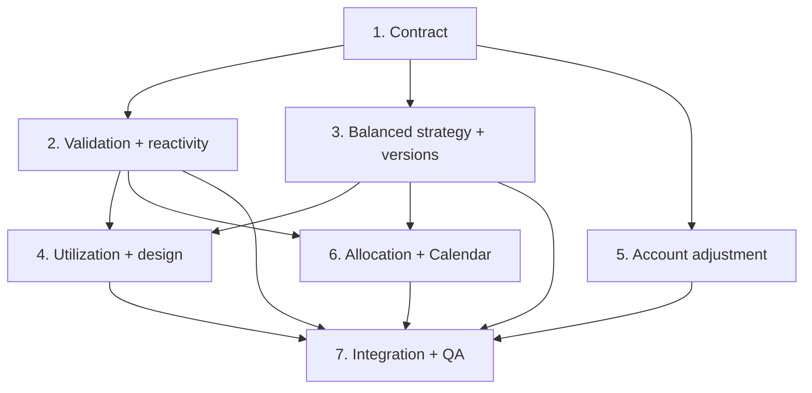

# Payday Playbook — Alpha v0.4.0 Multi-Agent Release Plan

## Outcome

Ship a backward-compatible **minor release** that makes setup honest about what each debt
type actually needs, makes every derived number react to upstream edits, upgrades
Balanced (Recommended) into a genuinely multi-objective strategy proven by full engine
simulations, fixes credit utilization with one canonical calculation, gives primary
actions a legible semantic button treatment, generalizes the checking-account adjustment
flow, and introduces a derived pay-cycle debt-allocation service with a Calendar debt
dashboard.

This document is the authoritative release contract and copy-paste prompt pack for
Fable 5 multi-agent work. The canonical registry is V4-01…V4-08 below. `soul.md` carries
the soul-level requirement per ID; `MVP_LAYOUT.md` carries screens, rules, models,
services, and acceptance criteria; `docs/releases/v0.4.0/VERSIONING.md` carries the
version contract.

Everything ratified for v0.1…v0.3.0 remains binding: F-01…F-16, V2-01…V2-18, and
V3-01…V3-16 as amended in `soul.md` are regression requirements. The privacy gate
(V3-12/V3-13) is permanent: no real person's financial data in any tracked artifact,
prompt, log, commit, or report — fictional fixtures only.

---

## 1. Semantic versioning decision

- Target app version: **`0.4.0`**. First prerelease tag: **`v0.4.0-alpha.1`** (tagged
  only when the build is actually cut; never pushed without owner authorization).
- Build number: **5** at the next distributed build.
- Persistence schema: **stays 3** — no stored field is added; derived services are
  mandated over redundant persisted state. Conditional bump path in VERSIONING.md §5.
- Calculation version: **4** for plans generated, previewed, or applied in 0.4.0
  (V4-03 changes calculation semantics). Every existing stamp (1/2/3) is frozen.
  `PlanContract.minimumModernCalculationVersion` stays **2** — the two constants are
  never collapsed (VERSIONING.md §5).
- Export schema: **4** (writes 4; reads 1–4) — semantic bump so older readers refuse
  calc-4 payloads by name (VERSIONING.md §5).
- User plan versions remain data, not software.
- External distribution remains blocked on the owner's Git-history decision (v0.3.0
  integration report §8). Preparing the release is in scope; distributing it is not.

---

## 2. Feedback translated into product requirements

| ID | Requirement | Acceptance-level behavior |
| --- | --- | --- |
| V4-01 | Debt-type-specific validation | A credit card is never asked for, warned about, or gap-listed on original principal — in the editors, the Bills & Debts chips, the Review step, or the Settings upgrade checklist. Installment-style debts keep original principal as a meaningful optional gap. One semantic source of per-type field relevance drives every validation and every editor. |
| V4-02 | Reactive onboarding/setup | Going backward, editing any upstream value, and proceeding forward recomputes every downstream validation, summary, preview, projection, and recommendation from the canonical current input state. No derived value survives an upstream edit; inputs themselves persist. Committing a cached plan preview whose inputs have since changed is impossible. |
| V4-03 | Smarter Balanced strategy | Balanced (Recommended) compares complete engine simulations of legitimate candidate attack orders — the pure avalanche baseline plus deterministic quick-win promotions — and selects by a transparent lexicographic guardrail policy (R-25…R-27). It explains its selection, quantifies the tradeoff when a quick win costs more estimated interest, and never claims a saving the engine did not prove. Fastest Safe remains the pure interest/payoff-aggressive baseline. Existing stored plans never change value. |
| V4-04 | Correct credit utilization | One canonical Decimal-safe utilization calculation — current revolving balance ÷ valid credit limit — feeds every screen, badge, insight, and threshold. Unknown or non-positive limits stay "unknown", never 0%. Balances above the limit legitimately exceed 100%. Display rounding is standardized and never truncates a real ratio to a misleading figure. |
| V4-05 | Primary CTA contrast | A reusable semantic primary-action button style with verified contrast in light and dark appearances. Interactive buttons never resemble disabled ones. Dynamic Type, VoiceOver, 44-pt targets. The named CTAs (Add Payment, View Full Plan) adopt it, and primary actions across the app converge on it. |
| V4-06 | Generic checking-account adjustment | The Add Entry menu offers exactly "Checking account adjustment", which opens a form with account picker (any active user-defined checking account), adjustment type, amount, date, and optional note. Corrections append auditable dated ledger deltas via `CashLedgerService`; "Set balance to…" computes and appends the delta. History is never rewritten; existing (legacy-shaped) ledger rows remain readable and correctly derived forever. No founding-user vocabulary in the generic flow. |
| V4-07 | Pay-cycle debt allocation | A canonical derived service reports, for the current pay cycle: carry-in from the prior cycle, the allocation that became available this cycle, qualifying payments recorded, and the remainder. Positive unused funds roll forward. Recording, editing, or deleting a payment recomputes immediately. Overpayment shows "$0 remaining / +$X over planned allocation", never negative spendable money. Planned allocation, actual cash, and recorded payments are labeled as three different things. Future allocations are never presented as spendable today. |
| V4-08 | Calendar debt dashboard | The Calendar tab gains a debt-progress dashboard: paid toward debts this month, current cycle allocation, carry-in, used, remaining, and the next payday's upcoming allocation; plus debts fully cleared this month. Wording is precise — dollars paid toward debt are never called "paid off". It updates immediately after any ledger or payment change, including edits that keep row counts equal. |

Carried-forward standing gates (not new IDs): every F/V2/V3 acceptance criterion, the
privacy scan, accessibility (Dynamic Type, VoiceOver, high contrast, Reduce Motion,
44-pt), Decimal-only money, comment discipline (V3-14), and the TESTING.md device
checklist posture.

---

## 3. Financial behavior contract

### 3.1 V4-03 — the Balanced selection policy (calc v4, rules R-25…R-27)

The full normative text lives in `MVP_LAYOUT.md` §5; this is the authoritative summary.
Constants live in `PlanContract` as named, product-tunable modeling constants (they are
product policy, not personal data):

```
balancedQuickWinHorizonPaychecks   = 3      // a quick win must retire within this many pay periods
balancedQuickWinMaxDelayPaychecks  = 1      // guardrail: overall payoff may slip at most this much
balancedQuickWinMaxExtraInterestRate = 0.01 // guardrail: ≤ 1% of baseline estimated interest…
balancedQuickWinMaxExtraInterestCap  = 50   // …and never more than $50 (Decimal)
```

**Scope.** The selector runs only for the Balanced scenario kind. Fastest Safe and
More Cushion remain pure R-08 avalanche under their own constraints. Onboarding plan
generation (no scenario) is untouched in value — calc v4 without promotions reduces to
calc v3, which reduces to calc v2, so V2-10's generated-avalanche contract still holds
to the cent.

**Mechanism (engine).** `ScenarioInput` and `StoredScenarioDefinition` gain
`quickWinPromotions: [UUID]` (default empty). Promoted debts — active, and
extra-principal `.eligible` only — sort ahead of all other debts in the R-08
extra-principal attack order (and the assembled payoff order), in list order, until
retired; the pure R-08 order resumes behind them. Promotions never alter minimums
funding, reserves, floor top-up, allowance, or shortfall math, so all four R-16
reconciliation identities hold unchanged. Promoting an ineligible or inactive debt is a
no-op with warning note `quickWinPromotionIneligible`. With an empty list the engine's
output is byte-identical to calc v3 (tested).

**Candidate enumeration (R-25, deterministic).**

1. Baseline **B0**: Balanced constraints, no promotions — exactly today's Balanced.
2. For each debt D that is active, `.eligible`, and not B0's first extra-principal
   target: D is a *pre-candidate* iff
   `D.balance ≤ Σ over B0's first balancedQuickWinHorizonPaychecks paychecks of
   (extraTotal + D's minimum payments)`. This arithmetic bound is optimistic (it ignores
   interest), so it can only over-include — it never excludes a true candidate; it exists
   to avoid needless simulations.
3. Each pre-candidate is simulated as **C(D)** = Balanced constraints +
   `quickWinPromotions = [D]` (single promotion per candidate; multi-promotion sets are
   deliberately out of scope — A-14). D is a *candidate* iff C(D) actually retires D
   within `balancedQuickWinHorizonPaychecks` paychecks of plan start.

**Guardrails (R-26).** A candidate C is *admissible* against B0 iff all of:

- **G1 (payoff delay):** `C.paycheckCount ≤ B0.paycheckCount + balancedQuickWinMaxDelayPaychecks`,
  and C is not flagged "not payable as configured".
- **G2 (interest):** `C.estimatedTotalInterest − B0.estimatedTotalInterest ≤
  min(balancedQuickWinMaxExtraInterestRate × B0.estimatedTotalInterest,
  balancedQuickWinMaxExtraInterestCap)`.
- **G3 (real simplification):** C's first account payoff date is strictly earlier than
  B0's first account payoff date (or B0 has none within the horizon and C does).

**Selection (R-26, lexicographic — no scoring weights).** Among admissible candidates:
earliest first-payoff date → lowest estimated total interest → earliest debt-free date →
promoted debt earliest in R-08 order at plan start → promoted debt UUID string. If no
candidate is admissible, **B0 is Balanced** — exactly the current behavior. Identical
inputs always produce the identical selection (R-22 extended).

**Transparency (R-27).** The Balanced `ScenarioResult` carries a
`BalancedSelectionRationale` (see §4): what was considered, what was selected, and the
engine-proven deltas versus the avalanche baseline — interest delta, payoff delay in
paychecks, first-payoff advance, and the promoted debt's released per-paycheck minimum.
When a quick win costs more estimated interest than the baseline, note
`quickWinCostsMoreInterest` states the amount; the scenario surface keeps the existing
cross-scenario deltas visible so the Fastest Safe comparison stays honest. No copy may
claim an interest saving unless both compared projections finished and the delta favors
the claim (the R-16/minimum-only precedent). Reason code `quickWinPromotion` marks
promoted payments in the schedule.

**Reproducibility.** Previewing runs the selector; **applying pins the selection**: the
persisted snapshot's `StoredScenarioDefinition.quickWinPromotions` carries the concrete
promotion, so regenerating the applied plan re-runs the engine with the pinned promotion
and never re-runs the selector. Stored calc-1/2/3 plans are untouched and reproduce under
their own stamps forever.

**Performance.** Balanced now costs 1 + (candidate count) engine runs. Candidate runs may
skip the minimum-only comparison projection (an internal engine option that never changes
stamped outputs). Agent 3 benchmarks and documents; the scenario screen keeps its loading
state; no engine call from a view body.

### 3.2 V4-07 — pay-cycle allocation arithmetic (R-28)

- **Cycle boundaries** come from the active plan's schedule (`PaydayPlanItem` dates, the
  same source the calendar resolves via `CalendarEventService.schedulePlan`); the current
  cycle is `[most recent plan payday ≤ today, next plan payday)`. Past the last item, the
  boundary extends by the live `IncomeSchedule` cadence (the `ReforecastService`
  precedent). Before the plan's first payday there is no current cycle — the dashboard
  shows the upcoming allocation instead. Exactly one implementation of this rule exists,
  in the allocation service; no second derivation.
- **Allocation becoming available** for a cycle = the opening payday's
  `plannedCardBudget` (the plan track's planned debt payment for that payday). It is
  *planned allocation* — never actual account cash.
- **Qualifying payments** in a cycle = `.cardPayment` ledger rows with `effectiveDate`
  in the cycle, minus `refundReversal`/`correction` rows carrying a `debtAccountID`.
  Check-in payments are already `.cardPayment` rows (with `paydayCheckInID`), so the sum
  never also reads `PaydayCheckIn`/`CheckInCardPayment` — that would double-count.
  Transfers (`.accountTransfer`, `.c2Transfer`) are not payments and never count.
- **Carry-in fold**, anchored at the active plan's first payday:
  `carryIn(first) = 0`; `available(N) = carryIn(N) + allocation(N)`;
  `carryIn(N+1) = max(0, available(N) − used(N))`. Overspending a cycle never produces
  negative carry-in — the excess is surfaced, not borrowed.
- **Display rule:** `remaining = max(0, available − used)`;
  `overage = max(0, used − available)`; overage renders as
  "$0 remaining · +$X over planned allocation".
- Activating a different plan re-anchors the fold at the new plan's first payday.
- All Decimal; `.rounded2` at display boundaries only.

### 3.3 V4-08 — monthly aggregates (R-29)

- "Paid toward debts this month" = the qualifying-payment sum (same rule as R-28) over
  the calendar month — labeled exactly that; never "paid off".
- "Debts cleared this month" = debts whose derived balance
  (`AccountBalanceService.debtBalances()`) is zero now and whose earliest
  zero-reaching event (authoritative snapshot or payment) falls in the month.
- The dashboard consumes the allocation service only; it performs no arithmetic of its
  own, and it updates on content changes, not row counts.

### 3.4 V4-04 — canonical utilization (R-12 as amended)

- One implementation: `UtilizationMath.utilization(balance:limit:)` (Foundation-only,
  landed with this contract). `nil` unless `limit > 0`; otherwise pure Decimal
  `balance / limit`. Values above 1 are legitimate.
- Every consumer routes through it: the model convenience
  (`DebtAccount.utilization(currentBalance:)`), the engine's `CreditUtilization`
  assembly, badges, insights, onboarding previews. The known reimplementations to retire:
  the onboarding editor preview, the Review-step aggregate, and the engine's inline
  ratio. Thresholds (≥30% info, ≥90% attention) are declared once and consumed
  everywhere.
- The balance input for display surfaces is the derived current balance
  (`AccountBalanceService.debtBalances()`), and the known divergences are closed: the
  plan screen's silent fall-back to `startingBalance` when balance derivation fails, and
  percent formatting that truncates toward zero (display rounds to nearest whole percent;
  "<1%" renders for small non-zero ratios rather than "0%").
- Unknown limit stays unknown (no badge, level `.unknown`) — including
  `creditLimitMarkedUnknown` cards. Original principal is never a utilization input.

### 3.5 V4-01 — debt-type field relevance

One semantic source on `DebtType` (model layer) drives validation and editors. Landed
with this contract: `DebtType.usesOriginalPrincipal` (`false` for `.creditCard`, `true`
otherwise); `DebtPresentation.showsOriginalPrincipal` now forwards to it. The full
relevance matrix (normative, `MVP_LAYOUT.md` §4/§6):

| Field | Credit card | Personal/auto/student loan | Medical / other |
| --- | --- | --- | --- |
| Current balance / remaining principal | required (blocker if absent) | required | required |
| APR | asked; 0%/missing → warning, never a block | asked; warning | asked; warning |
| Minimum / contractual payment | optional → R-06 estimator + gap | **required (blocker)** — A-06 unchanged | required (blocker) |
| Due day | optional gap | optional gap | optional gap |
| Credit limit | optional gap (unless marked unknown) | not applicable — never asked, never warned | not applicable |
| Original principal | **not applicable — never asked, never warned, never gap-listed** | optional gap ("required" chip in editor stays presentation-only; saving blank never blocks) | optional gap |
| Prepayment eligibility | always `.eligible` (cards) | tri-state, `.unknown` warns | tri-state, `.unknown` warns |

Non-blocking philosophy unchanged: only missing installment minimums (and the structural
blockers: no accounts, no income, no default income account) block generation.
`SetupCompletenessService` remains the single gap source; the Bills & Debts chip
warnings and the editors must agree with it exactly — three surfaces, one rule.

### 3.6 V4-02 — the reactivity rule

- **Inputs persist; derivations don't.** Any cached derived state (summaries, previews,
  gap lists, projections) must be invalidated by *content* changes to its inputs — never
  by row counts alone. The known count-keyed observers are re-keyed to content
  fingerprints (row IDs + `updatedAt`).
- **The commit-staleness guard:** the Review step's Generate caches a plan preview;
  Commit must verify the setup content fingerprint captured at Generate still matches the
  store, and otherwise regenerate (or force a re-Generate) before persisting. Persisting
  a stale preview is impossible by construction, and a test proves it.
- Back-navigation resets rely today on the step `switch`'s structural identity; that
  contract is now explicit — if the flow container changes, the invalidation must not
  silently disappear (pinned by test, not by view-tree accident).

---

## 4. Shared DTO / interface contracts (binding names — do not mint alternatives)

The v0.2.0/v0.3.0 lesson is pinned twice over: duplicated declarations merge cleanly and
fail at integration. One declaration each; engine code imports Foundation only; every
store→engine conversion routes through `PlanGenerationService.engineInput`.

**Landed in this contract commit (code):**

- `UtilizationMath` (`PaydayPlaybook/Support/UtilizationMath.swift`) —
  `static func utilization(balance: Decimal, limit: Decimal?) -> Decimal?` plus the
  canonical thresholds `informationalThreshold = 0.3`, `attentionThreshold = 0.9`.
  Consumers: Agent 2 (onboarding call sites), Agent 3 (engine `CreditUtilization`),
  Agent 4 (presentation, insights).
- `DebtType.usesOriginalPrincipal` (`Models/DebtAccount.swift`) — the single semantic
  predicate; `DebtPresentation.showsOriginalPrincipal` forwards to it.
- `PrimaryActionButtonStyle` + `ButtonStyle.primaryAction`
  (`Components/PrimaryActionButton.swift`) — the semantic API both Agent 4 (visual
  refinement, dark-appearance accent variant, contrast verification) and Agent 5
  (adoption in the Add Entry flows) build against. Agent 4 owns the file after this
  commit.

**Specified here, implemented by the named owner (docs-binding):**

- `PlanCalculationVersion.v4BalancedQuickWin = 4` — Agent 3, `PlanningContracts.swift`.
- `ScenarioInput.quickWinPromotions: [UUID]` (default `[]`) and
  `StoredScenarioDefinition.quickWinPromotions: [UUID]` (optional key, default empty;
  calc-v3 snapshot bytes unchanged) — Agent 3.
- `BalancedSelectionRationale` (Foundation-only, Codable, Equatable, Sendable) — Agent 3:
  `selection` (`.avalanche` | `.quickWin`), `promotedDebtID: UUID?`,
  `promotedDebtName: String?`, `candidatesConsidered: Int`,
  `interestDeltaVsAvalanche: Decimal`, `payoffDelayPaychecks: Int`,
  `firstPayoffAdvanceDays: Int?`, `releasedMinimumPerPaycheck: Decimal?`,
  `explanations: [String]`. Attached as `ScenarioResult.balancedRationale:
  BalancedSelectionRationale?` (nil for non-Balanced kinds).
- New codes — Agent 3: `ReasonCode.quickWinPromotion`;
  `PlanningNoteCode.quickWinSelected`, `.quickWinCostsMoreInterest`,
  `.quickWinPromotionIneligible`.
- `BalancedStrategySelector` — Agent 3, pure service implementing R-25/R-26 over
  `ScenarioCalculationService`'s engine runs; no SwiftData, no third bridge.
- `PlanContract` additions — Agent 3: the four `balancedQuickWin*` constants (§3.1) and
  `currentCalculationVersion = 4`; `minimumModernCalculationVersion` untouched.
- `DebtAllocationCalculating` protocol + `DebtAllocationService` — Agent 6, services
  layer (`ModelContext` + `DateProviding` like its peers):
  `func currentCycle(asOf: Date) throws -> PayCycleAllocation?` and
  `func monthlyProgress(month: Date) throws -> MonthlyDebtProgress`.
- `PayCycleAllocation` (value type) — Agent 6: `cycleStart: Date`, `nextPayday: Date`,
  `allocation: Decimal`, `carryIn: Decimal`, `available: Decimal`,
  `paidThisCycle: Decimal`, `remaining: Decimal`, `overage: Decimal`,
  `nextAllocation: Decimal?`, `nextAllocationDate: Date?`.
- `MonthlyDebtProgress` — Agent 6: `monthStart: Date`, `paidTowardDebts: Decimal`,
  `debtsCleared: [ClearedDebt]` (`id`, `name`, `clearedOn: Date`).
- Export constants — Agent 3: `ExportService.backupSchemaVersion = 4`,
  `importableSchemaVersions = 1...4` (both stamping sites; VERSIONING.md §5).

**Existing canon that must not be duplicated:** `PlanningInput`/`PlanningResult`,
`StoredPlanInput`/`StoredPlanResult`, `PlanGenerationService.engineInput`,
`ScenarioDefinitionBuilder` (the one store→definitions mapping),
`CashAccount`/`CheckingAccount` alias, `CashAccountRepository`, `CashLedgerService`,
`LedgerEntry`, `BalanceSnapshot`, `AccountBalanceService.debtBalances()`,
`SetupCompletenessService` (single gap source), `GeneratedPlanService.nextPlanName`,
`PlanningSnapshotCoder`.

---

## 5. UX and navigation contract

### 5.1 Add Entry menu (V4-06)

The global `+` sheet replaces the hard-coded "Checking 1 / 2 adjustment" item with
**"Checking account adjustment"**, opening one form: account picker (all active checking
accounts by user-defined name; preselected when only one exists), adjustment type
("Set balance to…" / "Adjust by amount"), amount, effective date, optional note. Both
types converge on `CashLedgerService.adjustBalance` (snapshot + `accountAdjustment`
delta row written together, provenance `user`) so the reconciliation companion-row
invariant holds. The legacy seven-kind adjustment sheet is retired (soul.md
amendment 6); its historical rows render and derive forever; the Note entry is
unaffected. The Windfall form's "Apply to debt (Checking 2)" / "Keep in Checking 1"
labels are re-derived from account roles/names with a legacy fallback — no founding-user
vocabulary remains in the generic flows.

### 5.2 Calendar debt dashboard (V4-08)

A dashboard card at the top of the Calendar tab: paid toward debts this month, current
cycle allocation + carry-in + used + remaining (or "$0 remaining · +$X over planned
allocation"), next payday's upcoming allocation, and debts cleared this month when any.
Honest labels per §3.2/§3.3. Updates immediately after ledger/payment changes, including
same-count edits.

### 5.3 Scenario surface (V4-03)

The Balanced card gains its rationale line(s): why the target was selected, with the
quantified tradeoff when applicable. No auto-apply, no new navigation; the detail
comparison shows the rationale in full. Missing-input behavior unchanged.

### 5.4 Primary actions (V4-05)

`.primaryAction` becomes the one style for primary CTAs (Today's Add Payment and View
Full Plan, debt detail's Add Payment, the quick-add forms' submit buttons, onboarding
continue buttons). Secondary/destructive actions keep system styles. Contrast ≥ 4.5:1 in
both appearances (AccentColor gains a dark-appearance variant); pressed and disabled
states visually distinct; 44-pt minimum targets; Dynamic Type; VoiceOver.

---

## 6. Multi-agent operating model

### Model and effort

Every thread: **Fable 5, Ultracode/highest effort, inspect first — plan — implement.**

### Shared rules

Each agent must: read `soul.md`, `MVP_LAYOUT.md`, this file,
`docs/releases/v0.4.0/VERSIONING.md`, and the v0.3.0 + v0.4.0 agent reports; inspect
code and tests before editing; work only in its own branch/worktree; keep every
concurrent checkout on its own `-derivedDataPath` **outside `~/Documents`** and its own
`xcrun simctl create`d simulator; run the UI suite alone with
`-parallel-testing-enabled NO`; never place personal financial values anywhere; never
weaken or skip a test to get green; coordinate shared interfaces through this contract;
write one report under `docs/releases/v0.4.0/agent-reports/`; commit only owned changes
with a scoped message; and return commit hash, changed files, tests, assumptions, risks,
and handoff notes.

### Branch and ownership map

| Agent | Branch | Owns (features) | Owns (files — single-owner) | Must not touch |
| --- | --- | --- | --- | --- |
| 1. Contract | `feature/v0.4-contract` | Registry, architecture contracts, versioning, shared leaf types | docs; `Support/UtilizationMath.swift` (this commit); initial `Components/PrimaryActionButton.swift` (ownership passes to Agent 4) | Feature implementation |
| 2. Validation & reactivity | `feature/v0.4-validation-reactivity` | V4-01, V4-02 | `SetupCompletenessService.swift`, `Features/Setup/*`, `Features/Onboarding/*`, `Models/DebtAccount.swift`, `ModelValidation.swift`, `SetupRepositories.swift`, `Components/SetupComponents.swift` | Engine/scenario files, `PlanContract`, ledger UI, Calendar |
| 3. Balanced strategy & versions | `feature/v0.4-balanced-strategy` | V4-03; calc-4 + export-4 bumps | `Services/Planning/*`, `ScenarioCalculationService.swift`, `ScenarioDefinitionBuilder.swift`, `ScenarioPlanActivationService.swift`, `ExtraPaymentInsightService.swift`, `PlanningDTO.swift`, `PlanContract.swift`, `ExportService.swift` (version constants only), `PlanGenerationService.swift`, `GeneratedPlanService.swift` | SwiftUI, SwiftData models, migration, ledger |
| 4. Utilization & design | `feature/v0.4-utilization-design` | V4-04, V4-05 | `Components/DebtPresentation.swift`, `Components/PrimaryActionButton.swift`, `Components/MoneyText.swift`, `Assets.xcassets`, `Features/Insights/*`, `Features/Debts/*`, `Features/Today/*`, `Features/Plan/*` (utilization/CTA sites) | Engine math, onboarding validation files, `QuickAddSheet.swift`, Calendar |
| 5. Account adjustment | `feature/v0.4-account-adjustment` | V4-06 | `Features/Ledger/*` (incl. `QuickAddSheet.swift`), `CashLedgerService.swift` (additive API only), `Features/Accounts/*` (only if reuse requires) | Engine, scenario UI, Calendar dashboard, onboarding |
| 6. Allocation & Calendar | `feature/v0.4-allocation-calendar` | V4-07, V4-08 | `Services/DebtAllocationService.swift` (new), `Features/Calendar/CalendarTabView.swift` | Engine internals, ledger entry forms, onboarding |
| 7. Integration & QA | `release/v0.4.0-alpha.1` | Merge, cross-feature fixes, regression/privacy/accessibility gates, versions, changelog, release docs | `project.pbxproj` versions, `CHANGELOG.md`, `TESTING.md`, `README.md` | Unplanned large features |

Only an owning agent or Agent 7 edits a shared implementation file. Cross-file needs
resolve through this contract, never parallel edits. Known hot spots pre-assigned:
utilization call sites inside Agent 2's onboarding files are **Agent 2's** edits (to the
Agent 1 helper); `QuickAddSheet.swift` is **Agent 5's** including its adoption of
`.primaryAction`; `TodayView.swift` is **Agent 4's**; `CalendarTabView.swift` is
**Agent 6's** (its Add Entry presentation line is untouched by Agent 5).

---

## 7. Dependency-aware launch order

### Wave 1 — Contract (this branch)

Docs, versioning, shared leaf types. Merge or distribute before implementation.

### Wave 2 — Foundations, parallel

Agents 2 and 3 concurrently. Agent 2's validation/reactivity work and Agent 3's calc-4
engine/selector are disjoint by file. Reconcile nothing mid-wave — the §4 names are
binding.

### Wave 3 — Surfaces, parallel, isolated worktrees

Agents 4, 5, 6 after Wave 2 lands (Agent 4 consumes Agent 3's rationale DTO for the
Balanced card and Agent 2's validation semantics for chips; Agent 6 consumes nothing
from Wave 2 but merges after to keep the order simple; Agent 5 depends only on Wave 1).

### Wave 4 — Integration (Agent 7)

Merge order **1 → 2 → 3 → 4 → 5 → 6**, per-diff PI review, full regression + privacy
gates, version/build stamp, truthful release recommendation.



---

## 8. Copy-paste prompts

## Prompt 2 — Validation and Reactive Setup Agent

```text
You are Agent 2, the Onboarding Validation and Reactive Setup owner for Payday Playbook v0.4.0.

Use Fable 5 with Ultracode/highest effort. Work only in feature/v0.4-validation-reactivity,
branched from the v0.4.0 contract commit. Plan first, then implement.

Read soul.md, MVP_LAYOUT.md, ALPHA_V0.4.0_MULTI_AGENT_PLAN.md, docs/releases/v0.4.0/VERSIONING.md,
the v0.3.0 agent reports, docs/releases/v0.4.0/agent-reports/agent-1-contract.md, and the
current onboarding/setup/validation code and tests.

Mission: V4-01 (debt-type-specific validation) and V4-02 (reactive setup state).

V4-01 required work:
1. Gate every original-principal ask on DebtType.usesOriginalPrincipal (landed by Agent 1 in
   Models/DebtAccount.swift): SetupCompletenessService must not emit the .originalPrincipal
   gap for credit cards; BillsAndDebtsState.warnings must not list "the original amount" for
   credit cards; the editors already hide the field for cards — all three surfaces now agree.
2. Unify DebtFormRules (DebtsStepView) with the plan's §3.5 relevance matrix so there is one
   semantic source; keep the non-blocking philosophy exactly (only installment minimums and
   the structural blockers block; "required" chips for loan original principal stay
   presentation-only).
3. Credit limit relevance: never ask non-card debts; respect creditLimitMarkedUnknown.

V4-02 required work:
1. Re-key every count-based invalidation of derived setup state to content (row IDs +
   updatedAt): BillsAndDebtsView's onChange of obligations.count/debts.count is the known
   instance; sweep for others.
2. Implement the commit-staleness guard on the Review step: Generate captures a content
   fingerprint of the canonical inputs; Commit re-verifies it and regenerates (or requires
   re-Generate) on mismatch. Persisting a stale preview must be impossible, proven by test.
3. Pin the back-navigation invalidation contract by test (edit upstream, go forward,
   every downstream summary/validation/preview reflects the new values) at every step
   boundary, not by relying on SwiftUI view identity accidentally.
4. Optional additive scope: retire the unrouted ObligationsStepView if removal is clean.

Constraints: inputs persist across navigation (V2-01 resumability untouched — the full
kill/resume matrix must stay green); SetupCompletenessService stays the single gap source;
no new DTOs; do not touch engine, PlanContract, ledger, or Calendar files. Fictional
fixtures only. Run OnboardingSetupTests, OnboardingProgressTests, DebtTypeTests,
DebtPresentationTests, and the new T-18/T-19 suites; run the full unit suite before
committing, with -derivedDataPath outside ~/Documents and your own simulator.

Write docs/releases/v0.4.0/agent-reports/agent-2-validation-reactivity.md. Commit only
owned changes with a scoped message and return the commit hash.
```

## Prompt 3 — Balanced Strategy and Calculation-Version Agent

```text
You are Agent 3, the Balanced Strategy and Calculation Version owner for Payday Playbook v0.4.0.

Use Fable 5 with Ultracode/highest effort. Work only in feature/v0.4-balanced-strategy,
branched from the v0.4.0 contract commit. Plan first, then implement.

Read soul.md, MVP_LAYOUT.md §5, ALPHA_V0.4.0_MULTI_AGENT_PLAN.md §3.1/§4,
docs/releases/v0.4.0/VERSIONING.md §5, the v0.3.0 agent-3 and agent-7 reports, and the
engine/scenario/DTO source and tests.

Mission: V4-03 — Balanced (Recommended) becomes a deterministic multi-objective strategy
selected over complete engine simulations — plus the calc-4 and export-4 version bumps.

Required work:
1. Engine: add quickWinPromotions: [UUID] to ScenarioInput and StoredScenarioDefinition
   (optional key, default empty; calc-v3 and calc-v2 snapshot bytes unchanged — extend the
   tolerant decoders). Promoted debts (active, .eligible only) sort ahead of the R-08
   extra-principal order and the assembled payoff order, in list order, until retired.
   Promotions never touch minimums funding, reserves, floor, allowance, or shortfalls —
   the four R-16 identities hold. Ineligible/inactive promotion → no-op +
   .quickWinPromotionIneligible warning. Empty list → byte-identical calc-v3 output.
2. PlanCalculationVersion gains .v4BalancedQuickWin = 4; gate the promotion field on it
   (a v3-stamped input carrying promotions is a validation error, not a silent ignore).
3. BalancedStrategySelector: implement R-25 candidate enumeration (arithmetic pre-filter,
   then full simulations), R-26 guardrails G1–G3 with the four PlanContract
   balancedQuickWin* constants, and the exact lexicographic selection. Pure, deterministic,
   Foundation-only, no third store→engine bridge — everything through
   PlanGenerationService.engineInput. Runs only for .balanced.
4. Rationale: BalancedSelectionRationale exactly as contracted in §4, attached as
   ScenarioResult.balancedRationale; new codes ReasonCode.quickWinPromotion,
   PlanningNoteCode.quickWinSelected/.quickWinCostsMoreInterest/.quickWinPromotionIneligible.
   Never claim a saving unless both compared projections finished and the delta proves it.
5. Version bumps, all stamping sites together (VERSIONING.md §5): PlanContract.
   currentCalculationVersion = 4; ScenarioCalculationService, ScenarioPlanActivationService,
   ExtraPaymentInsightService, PlanningInputBuilder, engineInput inference.
   minimumModernCalculationVersion stays 2 — extend the ReleaseIntegrationTests-style
   dispatch guards for calc 4 (upgraded calc-2/3 plans reach the modern engine; calc-1
   stays off it; new plans stamp 4). Applying Balanced pins the concrete promotion into
   the persisted snapshot; regeneration re-runs the engine, never the selector.
6. Export schema: ExportService.backupSchemaVersion = 4, importableSchemaVersions = 1...4,
   both stamping sites; update ExportCompatibilityTests/BackupPortingTests expectations
   (1/2/3 files still import; a 4 file round-trips).
7. Performance: candidate runs may skip the minimum-only comparison projection via an
   internal engine option that cannot change stamped outputs. Benchmark Balanced end-to-end
   on an 8-debt fictional fixture and document.

Tests: CalcV4ReductionTests (v4 no-promotions ≡ v3, byte-identical; chain to v2/v1 intact);
selector determinism, guardrail edge cases (G2 with zero baseline interest, ties at every
lexicographic level, no admissible candidate → pure avalanche), promotion mechanics and
R-16 identities, rationale correctness, stamping/dispatch guards, export round-trip.
Fictional values only. Run the full unit suite (own derived-data path outside ~/Documents,
own simulator) before committing.

Write docs/releases/v0.4.0/agent-reports/agent-3-balanced-strategy.md with formulas,
selector walkthrough on a fictional fixture, benchmark, tests, and handoff notes. Commit
owned changes and return the commit hash.
```

## Prompt 4 — Utilization and Design Agent

```text
You are Agent 4, the Utilization Correctness and Design/Accessibility owner for Payday
Playbook v0.4.0.

Use Fable 5 with Ultracode/highest effort. Work only in feature/v0.4-utilization-design,
branched after Wave 2 lands. Plan first, then implement.

Read soul.md, MVP_LAYOUT.md, ALPHA_V0.4.0_MULTI_AGENT_PLAN.md §3.4/§5.4, the v0.4.0
agent-1/2/3 reports, and the presentation/insights/plan code and tests.

Mission: V4-04 (one canonical utilization) and V4-05 (semantic primary-action buttons).

V4-04 required work:
1. Route every utilization computation through UtilizationMath (landed by Agent 1):
   DebtAccount.utilization becomes a forwarding convenience; the engine's CreditUtilization
   assembly (coordinate: that file belongs to Agent 3 — if Wave 2 already routed it, verify;
   otherwise it is your one sanctioned edit in Services/Planning, kept mechanical);
   badges, insights, plan overview. Onboarding-file call sites are Agent 2's — verify, don't edit.
2. Declare the 30%/90% thresholds once (UtilizationMath) and consume them in
   UtilizationDisplayLevel and the engine's UtilizationLevel.
3. Close the known divergences: PlanViewDataLoader must not silently substitute
   startingBalance when debtBalances() fails (surface the failure state instead); percent
   display rounds to nearest whole percent everywhere and renders "<1%" for small non-zero
   ratios — never a false 0%. Unknown/zero limits stay unknown; >100% renders correctly.
4. Reproduce and root-cause the reported "0% at high balance" on a fictional fixture;
   if the cause is one of the enumerated divergences, pin it with a regression test; if it
   is something new, fix it within your ownership or hand it to the owning agent by report.

V4-05 required work:
1. Take ownership of Components/PrimaryActionButton.swift; refine the visual treatment:
   AccentColor gains a dark-appearance variant; text contrast ≥ 4.5:1 in both appearances;
   pressed and disabled states visually distinct (disabled never mimics enabled and vice
   versa); minimum 44-pt targets; Dynamic Type scaling; VoiceOver labels/traits.
2. Adopt .primaryAction on the named CTAs (Today's Add Payment + View Full Plan, debt
   detail's Add Payment) and sweep primary actions in your owned files (Today, Debts,
   Insights, Plan). QuickAddSheet adoption is Agent 5's; onboarding is Agent 2's if taken.
3. Accessibility pass on every changed screen: Dynamic Type at accessibility sizes,
   VoiceOver, high contrast, Reduce Motion.

Run DebtPresentationTests, DebtTypeTests, InsightsView-related suites, PlanPresentationTests,
the new T-21 suite, and the full unit suite; UI-test additions for CTA visibility at
accessibility sizes. Own derived-data path outside ~/Documents; own simulator; UI suite
alone with -parallel-testing-enabled NO.

Write docs/releases/v0.4.0/agent-reports/agent-4-utilization-design.md (include the 0%
root-cause finding). Commit owned changes and return the commit hash.
```

## Prompt 5 — Checking-Account Adjustment Agent

```text
You are Agent 5, the Checking-Account Adjustment Workflow owner for Payday Playbook v0.4.0.

Use Fable 5 with Ultracode/highest effort. Work only in feature/v0.4-account-adjustment,
branched from the v0.4.0 contract commit. Plan first, then implement.

Read soul.md, MVP_LAYOUT.md, ALPHA_V0.4.0_MULTI_AGENT_PLAN.md §5.1, the v0.3.0 agent-2
report (cash ledger), and Features/Ledger, Features/Accounts, CashLedgerService,
AccountReconciliationService, LedgerEntry, and their tests.

Mission: V4-06 — replace the founding-user-specific "Checking 1 / 2 adjustment" quick-add
path with a generic checking-account adjustment flow.

Required work:
1. QuickAddSheet: the menu item becomes exactly "Checking account adjustment", opening one
   form: account picker (all active checking accounts by user-defined name via
   CashAccountRepository; preselected when exactly one exists), adjustment type
   ("Set balance to…" / "Adjust by amount"), amount, effective date, optional note.
2. Both types converge on CashLedgerService.adjustBalance (snapshot + accountAdjustment
   delta row written together in one save, provenance user) — "Adjust by amount" computes
   the stated balance as current + delta and routes through the same call, preserving the
   reconciliation companion-row invariant (snapshot and ledger row share createdAt).
   Additive service API only if genuinely needed; prefer reuse of AccountMovementSheet
   components where clean.
3. Retire the legacy CashAdjustmentView and its seven hard-coded kinds. Historical
   legacy-shaped rows must remain readable, rendered, and correctly included in every
   balance derivation (byte-for-byte store non-mutation test on a migrated fixture).
   The zero-amount Note entry path is untouched.
4. Sweep the remaining founding vocabulary out of the generic flows you own: the Windfall
   form's "Apply to debt (Checking 2)" / "Keep in Checking 1" labels derive from account
   roles/names with a legacy fallback. Do not touch check-in, Today, or Settings copy —
   out of scope this cycle; list any residual sites in your report for the registry.
5. Adopt .buttonStyle(.primaryAction) (landed by Agent 1) on the submit buttons of the
   forms you own.
6. Accessibility: labels, Dynamic Type, VoiceOver on the new form; calm non-shaming
   warnings for negative results (V3-03 tone).

Tests: menu copy; picker with 1..10 fictional accounts; set-balance delta math (positive,
negative, zero-delta writes snapshot only); pairing invariant; reconciliation unaffected;
legacy rows still derive; archive/edge accounts. Run CashLedgerServiceTests,
AccountsWorkspaceTests, ReviewRegressionTests, the new T-23 suite, and the full unit
suite. Own derived-data path outside ~/Documents; own simulator.

Write docs/releases/v0.4.0/agent-reports/agent-5-account-adjustment.md. Commit owned
changes and return the commit hash.
```

## Prompt 6 — Debt Allocation and Calendar Dashboard Agent

```text
You are Agent 6, the Debt Allocation Service and Calendar Dashboard owner for Payday
Playbook v0.4.0.

Use Fable 5 with Ultracode/highest effort. Work only in feature/v0.4-allocation-calendar,
branched after Wave 2 lands. Plan first, then implement.

Read soul.md, MVP_LAYOUT.md, ALPHA_V0.4.0_MULTI_AGENT_PLAN.md §3.2/§3.3/§5.2, the v0.3.0
agent-5 report, and CalendarTabView, CalendarEventService, PaydayPlanItem, PaydayCheckIn,
ReconciliationService, AccountBalanceService, PayScheduleGenerator, IncomeSchedule, and
their tests.

Mission: V4-07 (canonical derived pay-cycle debt-allocation service) and V4-08 (Calendar
debt dashboard).

Required work:
1. DebtAllocationService implementing DebtAllocationCalculating exactly as contracted
   (§4): currentCycle(asOf:) -> PayCycleAllocation?, monthlyProgress(month:) ->
   MonthlyDebtProgress. ModelContext + DateProviding like its service peers. No new
   persisted state — this is derived, deterministic arithmetic per R-28/R-29.
2. Cycle boundaries from the active plan's PaydayPlanItem dates (the calendar's
   schedulePlan source), extended past the last item by the live IncomeSchedule cadence;
   no current cycle before the first payday (return the upcoming allocation instead).
   This service is the only implementation of the boundary rule.
3. Qualifying payments: .cardPayment ledger rows by effectiveDate, minus debt-linked
   refundReversal/correction rows. Never also read PaydayCheckIn/CheckInCardPayment
   (check-in payments are already ledger rows — double-count hazard pinned by test).
   Transfers and c2Transfer rows never count.
4. Carry-in fold anchored at the active plan's first payday; max(0, …) per cycle;
   overage = max(0, used − available) surfaced as "$0 remaining · +$X over planned
   allocation"; plan activation re-anchors the fold.
5. Calendar dashboard card at the top of the Calendar tab with the §5.2 figures and
   precise wording ("Paid toward debts this month" — never "paid off" for dollars;
   "Planned allocation" — never presented as account cash; upcoming allocation labeled
   with its availability date). It consumes the service only and recomputes on content
   changes (row IDs + updatedAt fingerprint), not row counts — an amount edit with equal
   counts must refresh it (tested).
6. Accessibility: the card reads correctly under VoiceOver and at accessibility sizes;
   figures carry text meaning, not color alone.

Tests (T-24/T-25): boundaries across all four cadences, month-end/leap/DST fixtures;
fold determinism; overpayment display; edit/delete recompute; double-count guards
(check-in + quick-add payment on the same day counts once); plan-switch re-anchor;
cleared-debts attribution; dashboard update on same-count edits. Fictional fixtures only.
Run CalendarEventServiceTests, ReconciliationServiceTests, the new suites, and the full
unit suite. Own derived-data path outside ~/Documents; own simulator.

Write docs/releases/v0.4.0/agent-reports/agent-6-allocation-calendar.md. Commit owned
changes and return the commit hash.
```

## Prompt 7 — Integration, Regression, and Release QA Agent

```text
You are Agent 7, the Integration and Release QA owner for Payday Playbook v0.4.0-alpha.1.

Use Fable 5 with Ultracode/highest effort. Work in release/v0.4.0-alpha.1. Start only
after Agents 1–6 return commits and reports. Plan the merge, inspect every candidate
diff, then integrate.

Read soul.md, MVP_LAYOUT.md, ALPHA_V0.4.0_MULTI_AGENT_PLAN.md,
docs/releases/v0.4.0/VERSIONING.md, all v0.4.0 agent reports, the v0.3.0 agent-7 report
(the clean-merge collision pattern is recorded there for you), current Git status, and
TESTING.md.

Merge order: 1 → 2 → 3 → 4 → 5 → 6. Before each merge, verify ownership boundaries held
and review the diff for personal financial information (never paste detected values).
After each merge, build and run the unit suite — the v0.3.0 lesson is that textually
clean merges fail at compile or only in the merged tree.

Required end-to-end gates:
- every V4-01…V4-08 acceptance criterion in MVP_LAYOUT.md §11;
- full V2/V3 regression: migration value-preservation, resumable onboarding, scenario
  determinism, preview non-mutation, due-date/notification reconciliation, backup
  round-trip (now export schema 4 writing, 1–4 reading), privacy scans on the tracked
  tree, generated artifacts, and the Release binary;
- calc-version integrity: upgraded calc-2/calc-3 plans reach the modern engine; the
  calc-v1 baseline stays off it; new plans stamp 4; both calc-version representations
  agree; minimumModernCalculationVersion is still 2 (mutation-check the guards);
- the merged-tree defect hunt: cross-feature interactions this release invites —
  Agent 5's generic adjustment vs Agent 6's cycle sums; Agent 2's fingerprints vs
  Agent 6's dashboard refresh; Agent 4's style adoption vs Agent 5's forms; the Balanced
  rationale rendering vs Agent 4's scenario card work;
- accessibility and failure states on every changed screen; UI suite alone, serially,
  dedicated simulator; derived data outside ~/Documents.

Versioning (only you): set MARKETING_VERSION 0.4.0 after re-verifying the current value
is 0.3.0; set CURRENT_PROJECT_VERSION 5; update CHANGELOG.md truthfully (claim exactly
what shipped); update TESTING.md suite counts and add the v0.4.0 device-checklist items;
amend README.md. Do not tag unless the build is actually cut and all gates pass; never
push or distribute — external distribution remains blocked on the owner's history
decision, which you restate, not resolve.

Write docs/releases/v0.4.0/agent-reports/agent-7-integration-qa.md with merge hashes,
conflicts, test matrix, privacy scan counts, version values, known limitations, and
exactly one status: READY FOR ALPHA DEVICE TESTING, BLOCKED, or NOT READY, with reasons.
Commit the integrated release and return the hash.
```

---

## 9. Coordinator dashboard

| Gate | Owner | Evidence | Status |
| --- | --- | --- | --- |
| Contract, registry, versioning, shared types committed | Agent 1 | This plan, VERSIONING.md, agent-1 report, green suite | ☐ |
| Cards never asked for original principal; one relevance source | Agent 2 | T-18 + suite | ☐ |
| Setup derived state reactive; stale commit impossible | Agent 2 | T-19 + resume matrix green | ☐ |
| Balanced selector deterministic, guardrailed, explained; calc 4 + export 4 landed with dispatch guards | Agent 3 | T-20, CalcV4ReductionTests, benchmark | ☐ |
| One utilization implementation; 0% report root-caused | Agent 4 | T-21 + regression test | ☐ |
| Semantic primary CTA with verified contrast both appearances | Agent 4 | T-22 + UI/accessibility evidence | ☐ |
| Generic adjustment flow; legacy rows still derive | Agent 5 | T-23 + non-mutation fixture test | ☐ |
| Allocation service correct across cadences; no double count | Agent 6 | T-24 | ☐ |
| Calendar dashboard accurate, honest wording, instant refresh | Agent 6 | T-25 | ☐ |
| Full regression + privacy gates; versions stamped; truthful changelog | Agent 7 | Integration report | ☐ |
| Alpha recommendation issued | Agent 7 | Final status | ☐ |

---

## 10. Final definition of done

`v0.4.0-alpha.1` is ready for device testing only when:

1. all V4-01…V4-08 requirements are implemented and tested per `MVP_LAYOUT.md` §11;
2. all non-superseded F/V2/V3 requirements pass regression;
3. no existing stored plan changes value: calc stamps 1/2/3 are untouched and reproduce;
   calc v4 reduces to v3 (and onward to v2/v1) exactly, tested;
4. `minimumModernCalculationVersion` is still 2 and the dispatch guards pass mutation
   checks;
5. a migrated store keeps every pre-existing value through the release, exactly once;
6. the tracked tree, fixtures, logs, test artifacts, and reports pass the privacy scan;
7. export schema 4 round-trips and schema 1–3 files still import;
8. the Balanced card explains its selection and every claimed delta is engine-proven;
9. the pay-cycle and monthly figures reconcile to the ledger to the cent, with no
   double-counted payment;
10. accessibility and failure states are verified, device-only items documented;
11. `CHANGELOG.md` claims exactly what shipped; and
12. Agent 7 returns `READY FOR ALPHA DEVICE TESTING`.

Do not push tags, publish builds, rewrite Git history, or distribute reports without
explicit owner authorization.
